## Objetivos de aprendizaje

Al finalizar, podrás:

1. Interpretar el **régimen hídrico** y sus componentes.
2. Reconocer la variabilidad temporal y espacial de la precipitación.
3. Explicar los **índices de secuencias de días secos**.
4. Clasificar condiciones mediante **P y ETo**.
5. Identificar **períodos de crecimiento** y **eventos de interés agrícola**.

## ¿Qué es el régimen hídrico?

El **comportamiento de la disponibilidad de agua en un lugar** depende de las **entradas**, **salidas** y **almacenamiento** de agua.

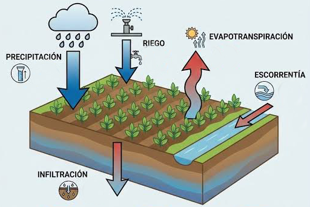{width="55%"}

## ¿Qué describe un régimen hídrico?

- **Cuándo** hay agua disponible y **durante cuánto tiempo**.
- Qué interrupciones ocurren dentro de los períodos húmedos.
- Cómo varía de **un año a otro**.
- Qué **déficits**, **excesos** y **eventos extremos** se producen.

::: {.nota}
La precipitación total no explica por sí sola la disponibilidad hídrica.
:::

## ¿Para qué estudiarlo?

- Estimar la **potencialidad agroambiental** de una región.
- Evaluar el **riesgo** asociado con la variabilidad del agua.
- Valorar el **impacto** de las actividades sobre su disponibilidad futura.

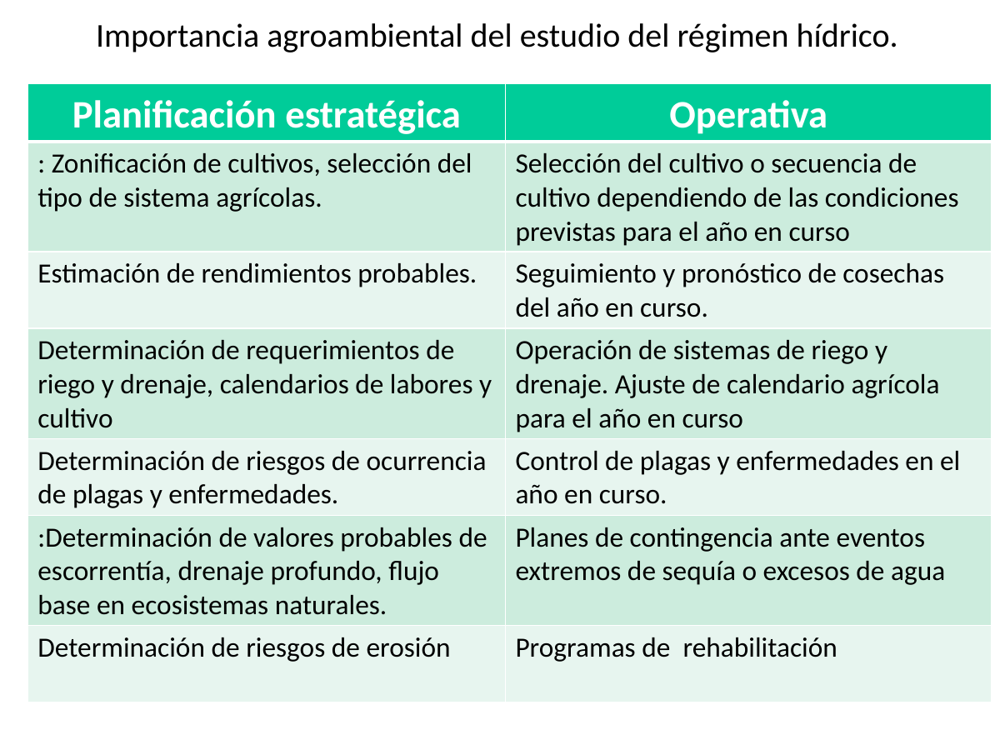{width="66%"}

## Decisiones agronómicas

::: {style="font-size: 32px;"}

| Horizonte | Aplicaciones |
|---|---|
| Estratégico | Zonificación, aptitud de cultivos, necesidades de riego y drenaje |
| Operativo | Calendarios agrícolas, secuencias de cultivos, cosechas |
| Contingencia | Sequías, excesos de agua, plagas, enfermedades y transitabilidad |

:::

## Estación de crecimiento

::: {style="font-size: 32px;"}

En el material se consideran dos condiciones:

- Temperatura que permita crecimiento: $T \ge 5\ ^\circ\mathrm C$.
- Oferta hídrica suficiente:

$$P + A_{suelo} > 0.5\,ETo$$

**Mensaje:** una temperatura favorable no garantiza crecimiento cuando el agua es insuficiente.

:::

##

::: {style="font-size: 32px;"}

{width="80%"}
:::

##

{width="50%"}

## Tres enfoques de análisis

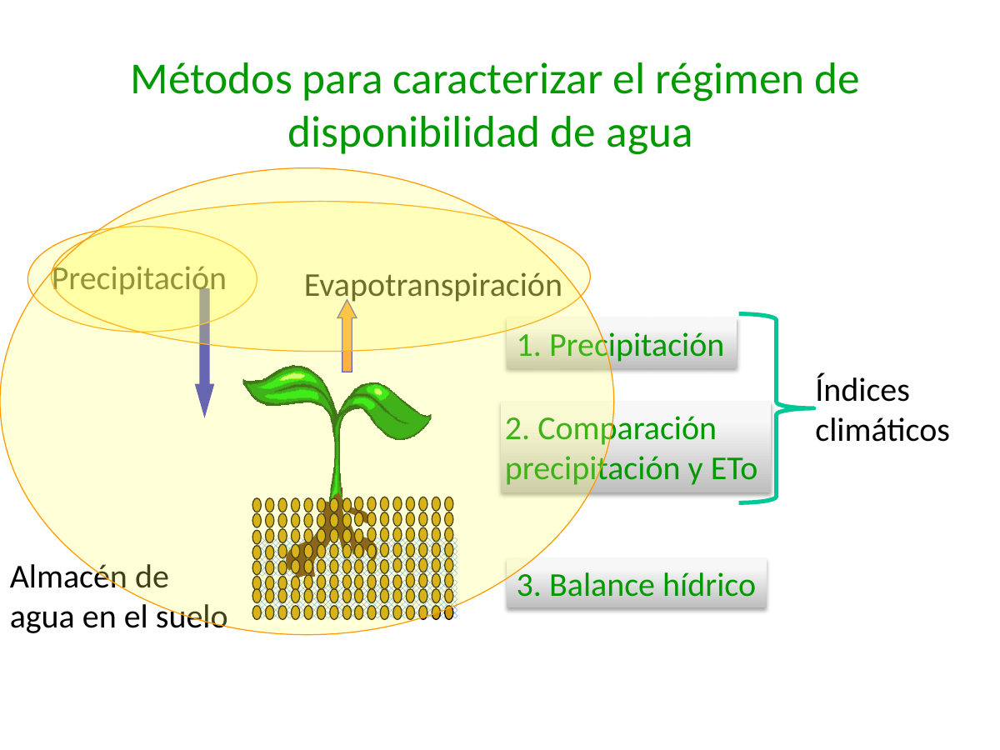{width="70%"}

- **Precipitación:** montos, días lluviosos, secuencias.
- **Comparación P–ETo:** oferta frente a demanda atmosférica.
- **Balance hídrico:** añade almacenamiento, déficit y exceso.

## ¿Por qué no basta con un promedio?

Dos lugares o años con igual lluvia total pueden diferir en:

- Distribución **estacional**.
- Número e **intensidad** de eventos.
- Duración de **veranitos**.
- Relación entre precipitación y demanda evaporativa.

::: {.nota}
En agricultura importa tanto **cuánto** llueve como **cuándo** lo hace.
:::

## Variabilidad espacial

La precipitación puede cambiar significativamente entre lugares cercanos, especialmente en zonas con relieve marcado.
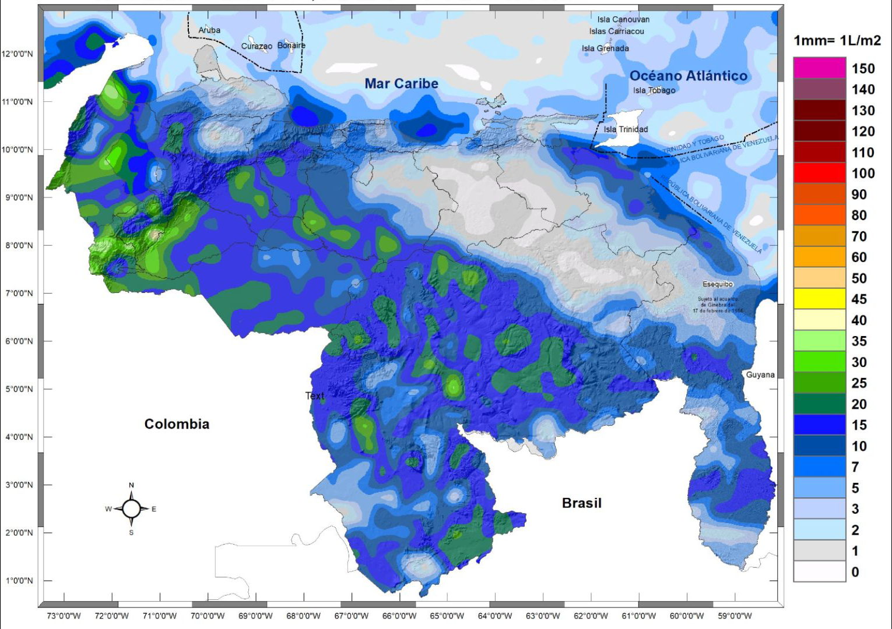{width="50%"}

**Implicancia:** los datos de una estación meteorológica no siempre representan a otra localidad o parcela.

**Pregunta:** ¿qué dificultades introduce la topografía al transferir información de lluvia?

##

{width="60%" height="550px"}

## Variabilidad estacional

Una cantidad anual similar puede concentrarse en una estación o distribuirse entre varios meses.

**Consecuencia:** cambia la duración de la estación favorable y la necesidad de riego de apoyo.

{width="60%" height="550px"}

## Variabilidad dentro del mes

- Pocos eventos de lluvia intensa.
- Muchos eventos frecuentes de baja intensidad.
- Períodos secos intercalados con lluvias.

**Un mismo total mensual no produce necesariamente la misma respuesta de los cultivos.**

{width="50%"}

##

{width="60%" height="550px"}

## Variabilidad interanual

Los promedios climáticos deben acompañarse de análisis **año a año**.

- Fechas de inicio y término del período favorable.
- Duración e intensidad de las rachas secas.
- Frecuencia y probabilidad de condiciones hídricas.

##

{width="60%" height="550px"}

##

{width="70%" height="550px"}

##

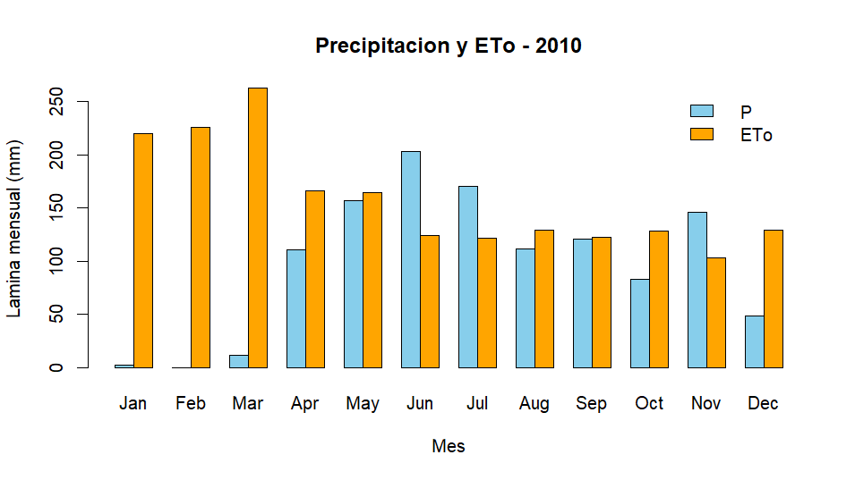{width="80%" height="750px"}  

##

{width="70%" height="550px"}

##

{width="70%" height="550px"}

##

{width="60%" height="750px"}

## Índice I · Secuencias de días secos

Las secuencias secas (*veranitos*) permiten evaluar las **interrupciones de lluvia** que los promedios mensuales ocultan.

Procedimiento:

1. Identificar días secos consecutivos.
2. Obtener la racha **máxima mensual de cada año**.
3. Construir frecuencias o probabilidades interanuales.

##

{width="80%" height="750px"}

##

{width="80%" height="750px"}

##

{width="80%" height="750px"}

##

{width="80%" height="750px"}

##

{width="80%" height="750px"}

## Paso 3 · Frecuencia y probabilidad

Dos preguntas distintas:

- **Dada una longitud:** ¿con qué probabilidad se alcanza o supera?
- **Dada una probabilidad:** ¿qué longitud de racha corresponde?

Las distribuciones se construyen con máximos mensuales observados **en distintos años**.

## Probabilidad de excedencia

Si $L$ es la longitud máxima de un veranito:

$$\Pr(L>10)$$

representa la probabilidad de una racha máxima **superior a 10 días**.

**Atención:** no es lo mismo $P(L>10)$ que $P(L\ge10)$.

## Riesgo agronómico de una racha

Una misma secuencia seca no implica idéntico riesgo en todos los sistemas.

Intervienen:

- Etapa fenológica del cultivo.
- Capacidad de almacenamiento de agua del suelo.
- Profundidad radical y demanda evaporativa.
- Disponibilidad de riego suplementario.

##

{width="80%" height="750px"}
##

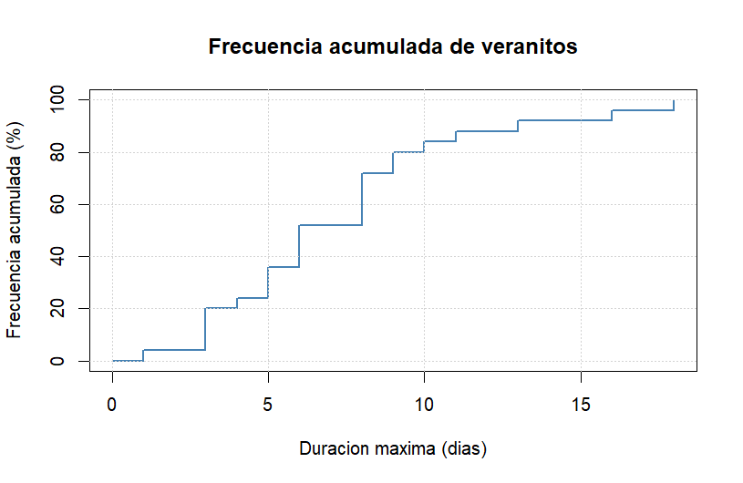{width="80%" height="750px"}

##

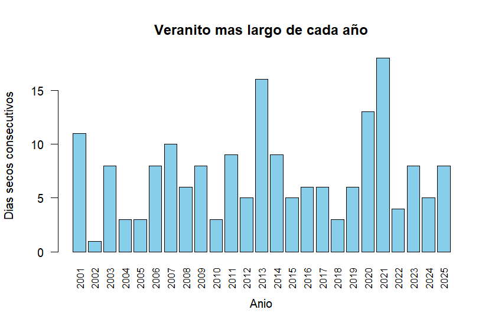{width="80%" height="750px"}
##

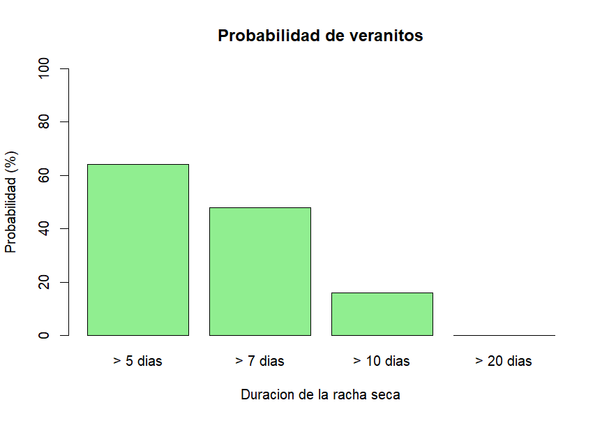{width="80%" height="750px"}

##

{width="80%" height="750px"}
##

Por medida general se utiliza el dato asociado al 75 %
de los años

La decisión de utilizar el valor asociado al 75 % de los años analizados
se justifica porque permite adoptar un criterio probabilístico conservador para 
la planificación agrícola, considerando la variabilidad interanual de las precipitaciones.

Este criterio también se aplica para las demás herramientas que serán 
explicadas durante esta clase. 

##

**¿Por qué utilizar el 75 %?**

1. Mayor confiabilidad: representa una condición que se ha cumplido en al menos tres
de cada cuatro años analizados, aproximadamente.

2. Consideración de la variabilidad climática: incorpora los años tempranos y tardíos, 
evitando depender exclusivamente de las condiciones promedio.

3. Reducción del riesgo agrícola: permite seleccionar fechas de planificación con una mayor
frecuencia histórica de ocurrencia del evento.

4. Interpretación práctica: facilita traducir los resultados climáticos en decisiones 
relacionadas con la siembra y la duración de la temporada lluviosa.

## Índice II · Comparación P–ETo

**P:** precipitación, aproximación a oferta climática de agua.

**ETo:** evapotranspiración de referencia, aproximación a demanda atmosférica.

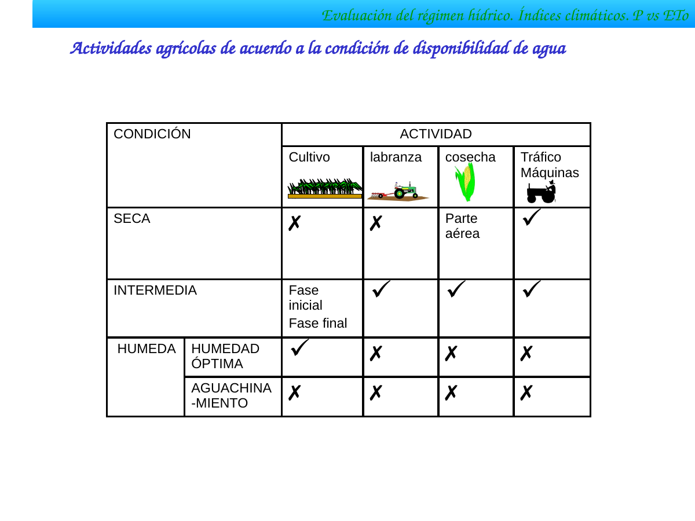{width="70%"}

## Condiciones según P y ETo

| Condición | Criterio |
|---|---|
| **Seca** | $P<0.5ETo$ |
| **Intermedia** | $0.5ETo\le P<ETo$ |
| **Húmeda** | $P\ge ETo$ |

Son categorías generales de disponibilidad climática.

## Humedad óptima y aguachinamiento

Dentro del intervalo húmedo, el material distingue:

- **Humedad óptima:** $ETo\le P\le1.34ETo$.
- **Aguachinamiento:** $P>1.34ETo$.

::: {.nota}
“Húmeda” es una categoría amplia; “óptima” y “aguachinamiento” la subdividen. Para una clasificación estadística sin solapamiento se usan cuatro clases: seca, intermedia, óptima y aguachinamiento.
:::

## Ejemplo de clasificación

Supongamos $ETo=100\ \mathrm{mm}$ en un mes:

| P (mm) | Clasificación |
|---:|---|
| 30 | Seca |
| 80 | Intermedia |
| 120 | Humedad óptima |
| 150 | Aguachinamiento |

*Ejemplo ilustrativo.*

## Frecuencia mensual de condiciones

Para cada mes del calendario:

1. Clasificar el mes de **cada año**.
2. Contar cuántos años corresponden a cada condición.
3. Expresar la proporción como porcentaje.

**Aplicación:** evaluar estabilidad y riesgo interanual.

##

{width="80%" height="750px"}

##

{width="80%" height="750px"}

##

{width="80%" height="750px"}

##

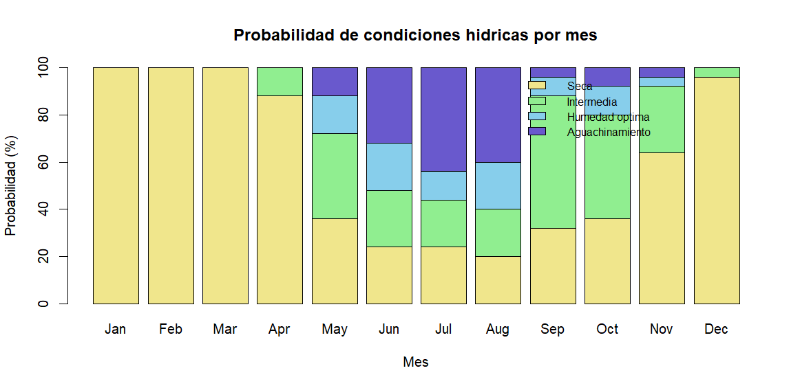{width="80%" height="750px"} 

## Método de períodos de crecimiento

En el enfoque atribuido a **FAO (1978)**, se comparan P y ETo para reconocer los períodos climáticos favorables.

##

{width="80%" height="750px"}

## Tres períodos de crecimiento

- **Seco:** $P<0.5ETo$.
- **Pre/post-húmedo:** $0.5ETo\le P<ETo$.
- **Húmedo:** $P\ge ETo$.

La secuencia de estos estados ayuda a delimitar **inicio, duración y final** de los períodos favorables.

##

{width="80%" height="750px"}

## No existe un único “año típico”

Las fechas y las duraciones deben caracterizarse **por año** y luego resumirse mediante probabilidades.

**Ejemplos de preguntas:**

- ¿Cuándo se inicia normalmente la fase húmeda?
- ¿Cuántos meses dura?
- ¿Qué frecuencia tienen los inicios tardíos?

##

{width="80%" height="750px"}

##

{width="80%" height="750px"}

##

{width="80%" height="750px"}

##

{width="80%" height="750px"}

##

{width="80%" height="750px"}

##

{width="80%" height="750px"}

## Eventos agrícolas

La presentación identifica eventos especialmente relevantes para agricultura de secano.

{width="77%"}

##

{width="80%" height="750px"}

##

{width="80%" height="750px"}

##

{width="80%" height="750px"}

##

{width="80%" height="750px"}
##

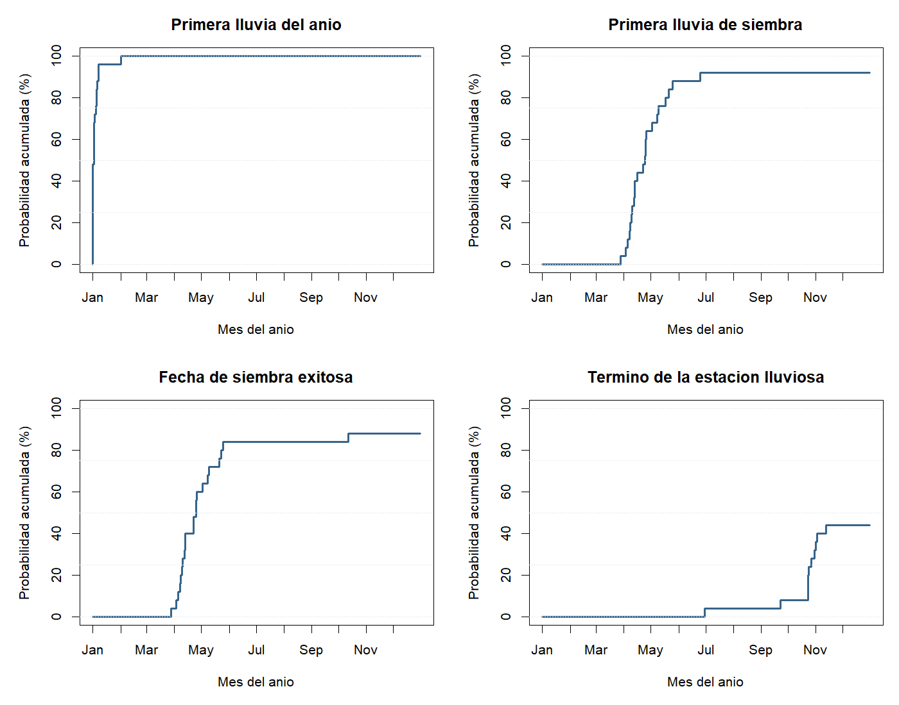{width="80%" height="750px"}

##

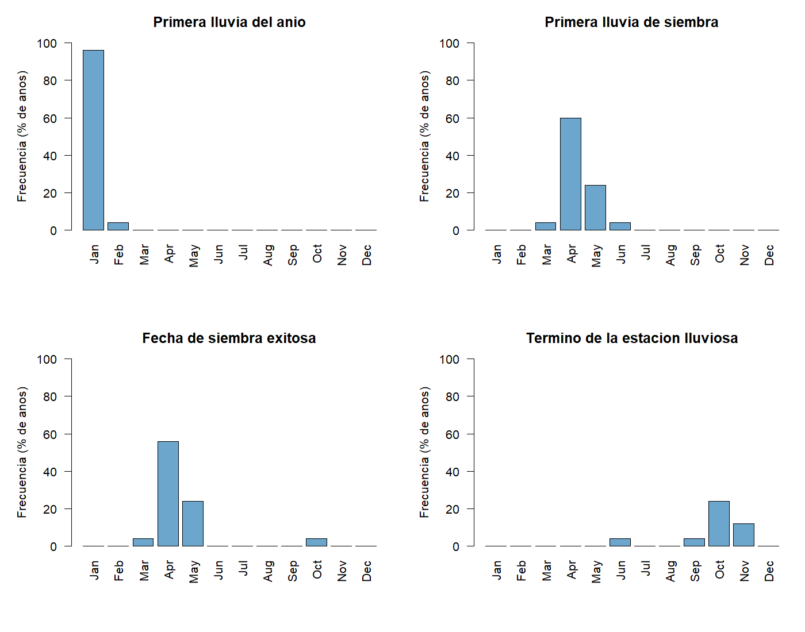{width="80%" height="750px"}

## **Sesión práctica en R:** 

### Prácticas de régimen hídrico. 
